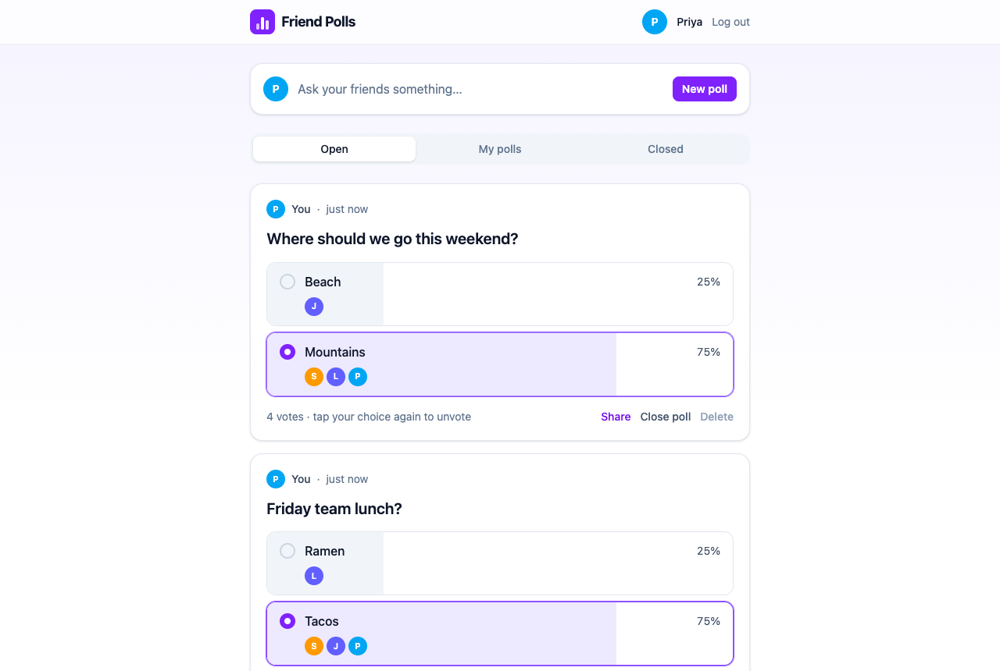
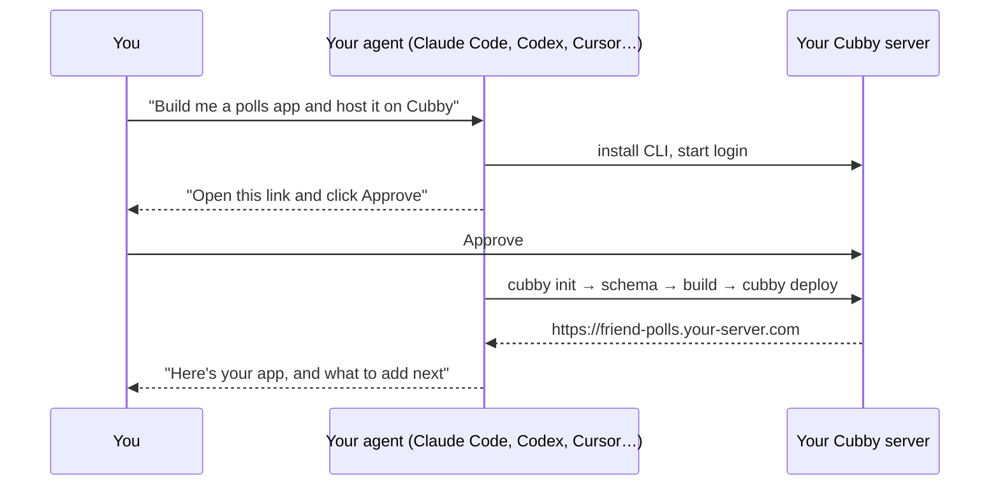
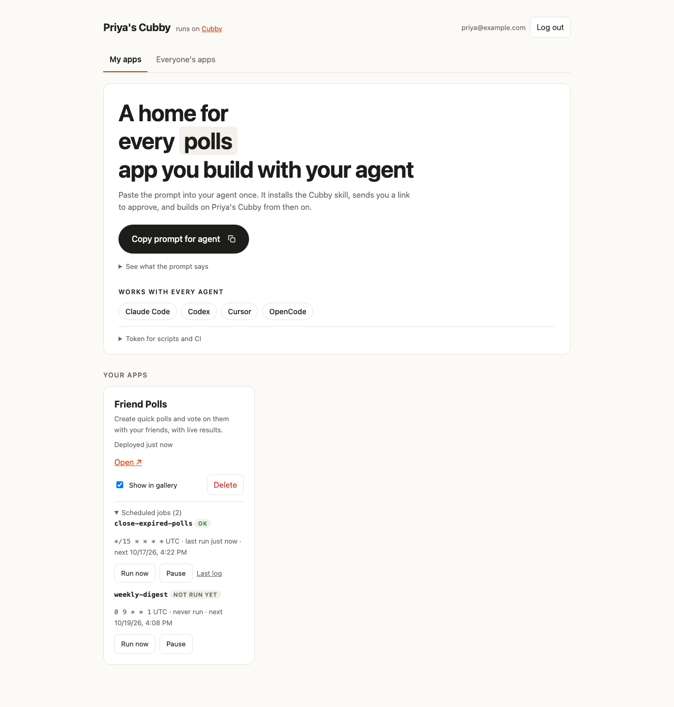
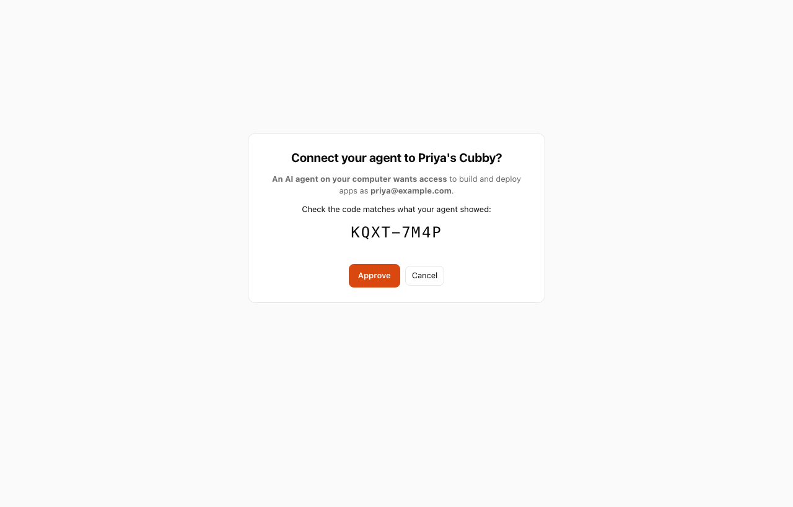
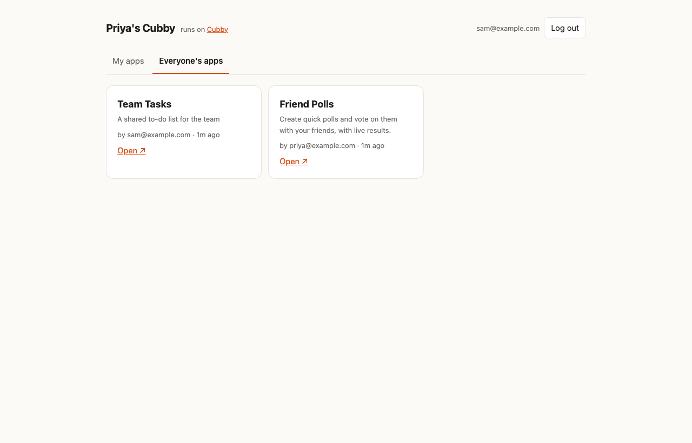
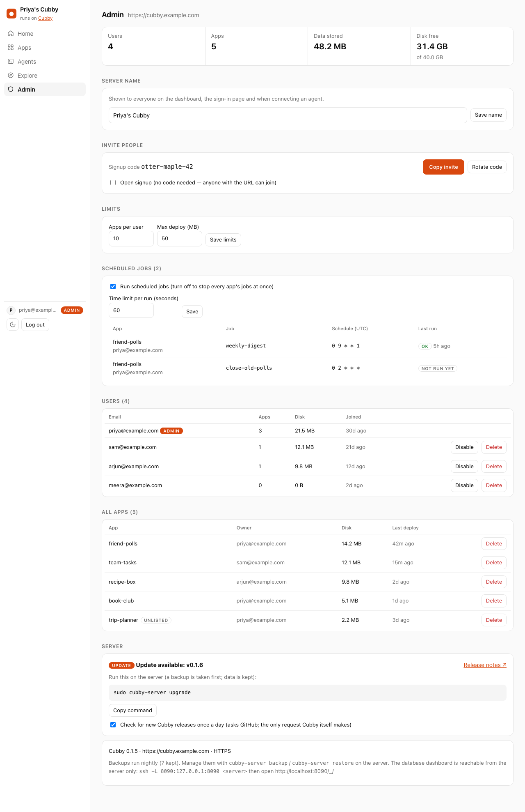
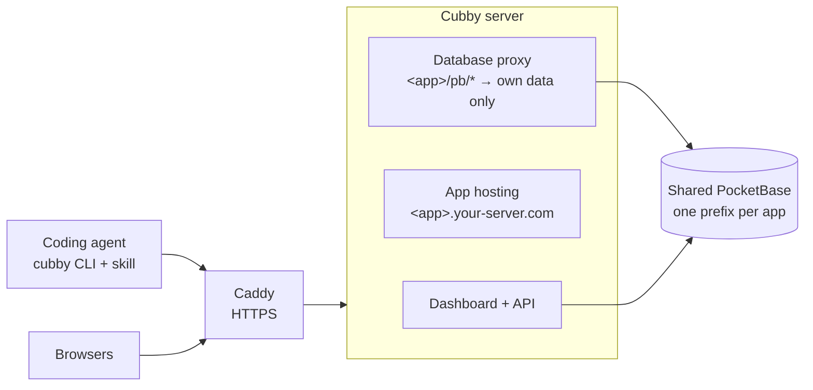

<div align="center">


# Cubby

**A home for the apps your agents build.**

Self-host one server, invite your friends or team, and let everyone's AI coding agent
build, deploy and share full-stack apps — each with a real database, logins and a live URL.

[**Documentation**](https://chaitanyadukkipaty.github.io/cubby/) ·
[Install](#install-a-server) ·
[How it works](#how-it-works) ·
[Contributing](CONTRIBUTING.md)

[](https://github.com/chaitanyadukkipaty/cubby/actions/workflows/test.yml)
[](https://chaitanyadukkipaty.github.io/cubby/)




<sub>Friend Polls: built and deployed by Claude Code from one sentence, in about three minutes.</sub>

</div>

---

## What it feels like

You type one sentence to your coding agent:

> Build me an app where my friends can create polls and vote on them, and host it on Cubby.

The agent sets itself up, sends you **one link to approve**, designs the data model and its security rules,
builds the UI, deploys it, and replies with the URL. Your friends see it in the server's gallery and can use it right away.



## Why Cubby

Coding agents can write a whole web app from a sentence. **Hosting it is the hard part**: it needs a database,
user accounts, a URL, and a way for friends to use it. Hosted builders solve that, but your apps live on someone
else's platform and you can't bring your own agent.

|  | **Cubby** | Hosted builders | A VPS by hand |
| --- | :---: | :---: | :---: |
| You own the server and data | ✅ | — | ✅ |
| Use the agent you already like | ✅ | — | ✅ |
| Database, logins, uploads, realtime per app | ✅ | ✅ | per app, by hand |
| One-command deploys the agent runs itself | ✅ | ✅ | — |
| Friends get their own accounts and apps | ✅ | separate accounts | — |

## Features

- **Agent-native.** A skill teaches Claude Code, Codex, Cursor and OpenCode to set up, build and deploy by themselves. They log in through a browser approval, so nobody pastes passwords or tokens into a chat.
- **Real backend for every app.** Collections, user accounts, file uploads and live updates from a shared [PocketBase](https://pocketbase.io). Each app is walled off by collection prefix, and its security comes from database rules.
- **One-command deploys.** `cubby deploy` pushes schema changes, builds and publishes. The last 10 deploys are kept for instant rollback.
- **Safe by default.** Schema pushes never delete data. Apps can't touch each other's data or logins. Only owners can change their apps.
- **Made for groups.** Invite with a signup code, browse everyone's apps in a gallery, and manage users, limits and disk from an admin tab.
- **Easy to run.** One install script, one Docker container, automatic HTTPS, nightly backups, one-command upgrades.

<table>
<tr>
<td width="50%"><p align="center"><sub>Your dashboard: connect your agent, see your apps</sub></p></td>
<td width="50%"><p align="center"><sub>One click to connect an agent</sub></p></td>
</tr>
<tr>
<td width="50%"><p align="center"><sub>Everyone's apps</sub></p></td>
<td width="50%"><p align="center"><sub>Admin: invites, limits, users, disk</sub></p></td>
</tr>
</table>

## Install a server

On a Linux VPS with ports 80 and 443 open:

```sh
curl -fsSL https://raw.githubusercontent.com/chaitanyadukkipaty/cubby/main/install.sh | sudo bash
```

It asks for a domain (optional), an admin email, a password and a name for your server (like "Priya's Cubby"),
then prints your URL and a **signup code**.
Send both to your friends.

| Mode | App URLs | HTTPS |
| --- | --- | --- |
| **Domain** (point `example.com` and `*.example.com` at the server) | `https://<app>.example.com` | Automatic |
| **No domain** | `http://<app>.203-0-113-5.sslip.io` | No, so traffic is unencrypted |

Switch later with `sudo cubby-server set-domain example.com`. See the [full install guide](https://chaitanyadukkipaty.github.io/cubby/#install).

## Connect your agent and build

1. Open the server URL and **sign up** with the signup code.
2. Run the command shown on your dashboard, once:
   ```sh
   curl -fsSL https://your-server.com/skill.sh | sh
   ```
3. Ask your agent for an app, in plain words. That's it.

<details>
<summary><b>CLI reference</b> (your agent runs these; every command takes <code>--json</code>)</summary>

| Command | What it does |
| --- | --- |
| `cubby login <server>` | Log in by approving a link in the browser (`--token` for CI) |
| `cubby init <app>` | Create an app from the template |
| `cubby deploy -m "…"` | Push schema if changed, build, publish (`--unlisted` hides it from the gallery) |
| `cubby deploys` / `cubby rollback <id>` | List deploys, restore one instantly |
| `cubby schema push \| pull \| drop` | Manage the data model (push never deletes) |
| `cubby projects` / `info` / `link` / `delete` | Manage apps |
| `cubby skill install \| remove \| status` | Manage the agent skill |

</details>

## How it works



- Every app gets its own **subdomain**, so apps can't read each other's logins in the browser.
- App `polls` owns collections named `polls__*`. The proxy only lets the app reach those, and rejects logins issued by other apps.
- Apps are static **Vite + React + Tailwind** frontends; security lives in each collection's API rules.
- One Docker container runs Caddy, the Cubby server (Node.js) and PocketBase, with a single data volume.

Read more: [security model](https://chaitanyadukkipaty.github.io/cubby/#security) · [data and rules](https://chaitanyadukkipaty.github.io/cubby/#schema) · [running the server](https://chaitanyadukkipaty.github.io/cubby/#admin)

## Develop

```sh
git clone https://github.com/chaitanyadukkipaty/cubby && cd cubby
cp .env.example .env
npm run setup     # downloads PocketBase into ./bin, installs dependencies
npm run dev       # http://localhost:8080 · apps at http://<app>.localhost:8080
```

```
server/    control API, app hosting, database proxy, dashboard (public/)
cli/       the cubby CLI, the app template (template/) and the agent skill (skill/)
docker/    container entrypoint and the cubby-server management script
docs/      this project's documentation site (GitHub Pages)
tests/     unit, integration and browser tests
```

### Tests

| Command | Runs |
| --- | --- |
| `npm run test:unit` | Fast unit tests, no network |
| `npm run test:integration` | Tests against a real server and PocketBase |
| `npm run test:e2e` | Browser tests for the dashboard and the app template (Playwright) |
| `npm run coverage` | Unit and integration tests with a coverage report in `coverage/` |
| `npm test` | All of the above, in pyramid order |

## Contributing

Contributions are welcome, from people and their agents. Read **[CONTRIBUTING.md](CONTRIBUTING.md)** first. In short:

1. Open an issue for anything bigger than a small fix, and agree on the approach.
2. Branch from `main` (`feat/…`, `fix/…`, `docs/…`) and use [Conventional Commits](https://www.conventionalcommits.org/).
3. Add tests at the right level of the pyramid, update the docs, and run `npm test`.
4. Open a pull request using the template. CI must pass.

Please follow our [Code of Conduct](CODE_OF_CONDUCT.md), and report security problems privately as described in [SECURITY.md](SECURITY.md).
Notable changes are listed in the [changelog](CHANGELOG.md).

## Status and limits

Cubby is early. It's built for groups who trust each other, not as a hostile multi-tenant cloud.

- All apps share one SQLite database, which suits a group of friends or a small team.
- Not yet supported: server-side code, cron jobs, custom domains per app, single sign-on across apps, app emails.
- Coming next: one CLI for several servers.
