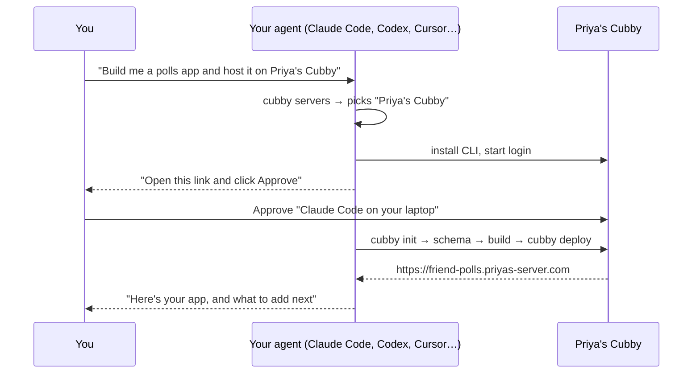
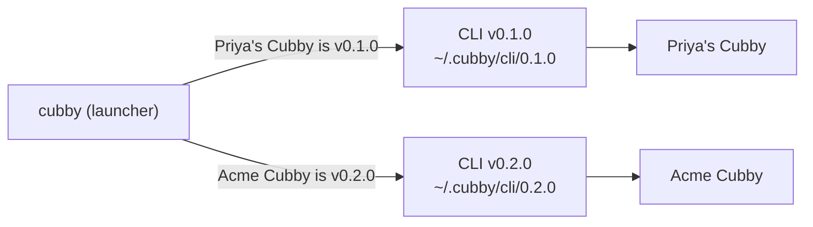
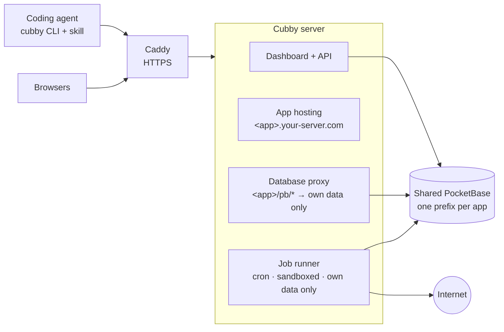

<div align="center">


# Cubby

**A home for the apps your agents build.**

Self-host one server, give it a name like **Priya's Cubby**, invite your friends or team, and let everyone's
AI coding agent build, deploy and share full-stack apps — each with a real database, logins and a live URL.

[**Documentation**](https://chaitanyadukkipaty.github.io/cubby/) ·
[Install](#install-a-server) ·
[Several servers](#belong-to-several-cubbies) ·
[How it works](#how-it-works) ·
[Contributing](CONTRIBUTING.md)

[](https://github.com/chaitanyadukkipaty/cubby/actions/workflows/ci.yml)
[](https://chaitanyadukkipaty.github.io/cubby/)


<sub>Friend Polls: built and deployed by Claude Code from one sentence, in about three minutes.</sub>

</div>

---

## What it feels like

You type one sentence to your coding agent:

> Build me an app where my friends can create polls and vote on them, and host it on Priya's Cubby.

The agent finds the server you named, sets itself up, sends you **one link to approve**, designs the data model and
its security rules, builds the UI, deploys it, and replies with the URL. Your friends see it in the server's gallery
and can use it right away.



A week later you ask for more, and it doesn't have to happen in anyone's browser:

> Close polls automatically when they expire, and email everyone a digest of new polls every Monday.

The agent stores the email service's API key as a secret, writes two **scheduled jobs** next to the app, deploys,
runs each one once to check it works, and tells you when they'll run next.

## Why Cubby

Coding agents can write a whole web app from a sentence. **Hosting it is the hard part**: it needs a database,
user accounts, a URL, and a way for friends to use it. Hosted builders solve that, but your apps live on someone
else's platform and you can't bring your own agent.

|  | **Cubby** | Hosted builders | A VPS by hand |
| --- | :---: | :---: | :---: |
| You own the server and data | ✅ | — | ✅ |
| Use the agent you already like | ✅ | — | ✅ |
| Database, logins, uploads, realtime per app | ✅ | ✅ | per app, by hand |
| One-command deploys the agent runs itself | ✅ | ✅ | — |
| Friends get their own accounts and apps | ✅ | separate accounts | — |

## Features

- **Agent-native.** A skill teaches Claude Code, Codex, Cursor and OpenCode to set up, build and deploy by themselves. They log in through a browser approval, so nobody pastes passwords or tokens into a chat, and each login becomes its own named agent ("Claude Code · your-laptop") with its own key.
- **Real backend for every app.** Collections, user accounts, file uploads and live updates from a shared [PocketBase](https://pocketbase.io). Each app is walled off by collection prefix, and its security comes from database rules.
- **One-command deploys.** `cubby deploy` pushes schema changes, builds and publishes. The last 10 deploys are kept for instant rollback.
- **Scheduled jobs.** Apps can run code on a cron schedule (digests, reminders, cleanups, syncing from an API) with encrypted secrets. Each run is sandboxed and can only reach its own app's data and the public internet.
- **Safe by default.** Schema pushes never delete data. Apps can't touch each other's data or logins. Only owners can change their apps.
- **Made for groups.** Each server has its own name ("Priya's Cubby"). Invite with a signup code, browse everyone's apps in a gallery, and manage users, limits and disk from an admin tab.
- **Many servers, one agent.** Belong to your friends' cubby and your team's: one skill and one CLI know them all by name, even when they run different Cubby versions.
- **Easy to run.** One install script, one Docker container, automatic HTTPS, nightly backups, and versioned releases: the Admin tab tells you when one is out, and `cubby-server upgrade` installs it after a backup. Admins (or their agent) see where the disk goes and manage backups and older deploys with `cubby admin storage`, `cubby admin backups` and `cubby admin deploys`.

<table>
<tr>
<td width="50%"><p align="center"><sub>Your dashboard on Priya's Cubby: connect your agent, see your apps and their jobs</sub></p></td>
<td width="50%"><p align="center"><sub>One click to connect an agent to a named server</sub></p></td>
</tr>
<tr>
<td width="50%"><p align="center"><sub>Everyone's apps</sub></p></td>
<td width="50%"><p align="center"><sub>Admin: server name, invites, limits, jobs, users, disk, updates</sub></p></td>
</tr>
</table>

## Install a server

On a Linux VPS with ports 80 and 443 open (in IP mode, any free port works; see below):

```sh
curl -fsSL https://raw.githubusercontent.com/chaitanyadukkipaty/cubby/main/install.sh | sudo bash
```

It asks for a domain (optional), an admin email, a password and a name for your server (like "Priya's Cubby"),
then prints your URL and a **signup code**.
Send both to your friends.

| Mode | App URLs | HTTPS |
| --- | --- | --- |
| **Domain** (point `example.com` and `*.example.com` at the server) | `https://<app>.example.com` | Automatic |
| **No domain** | `http://<app>.203-0-113-5.sslip.io` | No, so traffic is unencrypted |

Switch later with `sudo cubby-server set-domain example.com`. See the [full install guide](https://chaitanyadukkipaty.github.io/cubby/#install).

**Port 80 already taken** (by nginx, another app…)? In IP mode the installer says what holds it and offers a free
port, e.g. 8080, so your URL becomes `http://203-0-113-5.sslip.io:8080` and apps
`http://<app>.203-0-113-5.sslip.io:8080`. Open that port in your cloud firewall. The port is kept for good, since it's
part of every URL. A domain always needs 80 and 443, because Let's Encrypt only checks those; the installer and
`set-domain` refuse, naming what holds them, until they're free.

### Choose a version, and upgrade

The installer installs the **latest release**. To pick something else, pass options after `bash -s --`:

```sh
curl -fsSL https://raw.githubusercontent.com/chaitanyadukkipaty/cubby/main/install.sh | sudo bash -s -- --version 0.1.1
curl -fsSL https://raw.githubusercontent.com/chaitanyadukkipaty/cubby/main/install.sh | sudo bash -s -- --ref my-branch
```

`--domain`, `--no-domain`, `--admin-email`, `--admin-password-file` and `--name` answer the questions up front, for an
install with no prompts. `--http-port <port>` (IP mode) and `--pb-port <port>` (PocketBase admin, loopback only,
default 8090) pick the host ports; without a terminal, a busy port stops the install with the option to pass.

When a new release is out, the Admin tab says so, with the release notes. On the server:

| Command | Does |
| --- | --- |
| `sudo cubby-server upgrade` | Back up, then move to the latest release (or keep following the branch you installed) |
| `sudo cubby-server upgrade --version 0.1.1` | Move to a specific release, including rolling back |
| `sudo cubby-server upgrade --ref <branch\|tag\|commit>` | Run any ref, e.g. to try a fix before it's released |
| `sudo cubby-server version` | Show what's running, what it follows, and the latest release |

A server built from a release reports its version, like `0.1.1`. Anything else reports the commit too, like
`0.1.1-dev+b2cb75c`, so you always know exactly what code is running. Releases are cut by the maintainer and published
automatically; see [Releases](CONTRIBUTING.md#releases).

### Disk and backups

Every night Cubby backs up the database and the deployed sites, and keeps the newest 7 (a server setting). As the
admin, you or your agent can see where the disk goes and free some of it from your own machine, with your admin
login:

```sh
cubby admin storage                    # database, uploads, current and older deploys, backups, free disk; per app
cubby admin backups                    # backups by date: database size, sites size, total
cubby admin backups create             # back up now (waits until it's done; --no-wait to return at once)
cubby admin backups delete 2026-10-01 --yes
cubby admin backups keep 3 --yes       # keep 3 nightly backups from now on; says what that deletes and frees
cubby admin deploys blog               # every deploy of an app, * marks the one it serves
cubby admin deploys blog prune --keep 2 --yes      # delete older deploys, oldest first, sparing the newest 2
cubby admin deploys blog delete <deploy-id> --yes  # delete one older deploy
```

**How many backups to keep** (1 to 90) is a server setting. `BACKUP_KEEP` in the env file only seeds it on first boot;
servers set up before the setting existed keep using `BACKUP_KEEP` (7 if unset) until you change it. The change applies
at the next nightly backup, which deletes whole pairs by date beyond the newest N. `keep` tells you first: lowering
it prints the dates that will go and the space that frees, and needs `--yes`; raising it estimates the extra disk
from your average backup.

**Older deploys** are what `cubby rollback` goes back to (each app keeps its last 10). Deleting them frees their
files and their jobs and takes them off the app's rollback list. The deploy an app is serving is never deleted:
roll back to another one first if you really want it gone.

A backup is a pair of files, `cubby-<date>.zip` (database) and `sites-<date>.tar.gz` (sites and the secrets key), and
delete always removes both. Deleting the newest backup prints a warning; deleting the only one is refused unless you
add `--leave-none`. The storage numbers are measured when you ask and reused for 5 minutes. Restoring stays on the
server, on purpose: `sudo cubby-server restore <date>`. Anyone who isn't an admin gets a clear "needs an admin
account" error.

## Connect your agent and build

1. Open the server URL and **sign up** with the signup code.
2. Copy the setup prompt from your dashboard and paste it into your agent (Claude Code, Codex, Cursor or OpenCode),
   once per server. It has your server's name and URL filled in:
   ```text
   I'd like you to set up Cubby: Priya's Cubby at https://your-server.com, a self-hosted server where you build and host web apps for me.
   Install it as a skill if I have npm: npx skills add chaitanyadukkipaty/cubby --skill cubby -g
   If not, do this instead: curl -fsSL https://your-server.com/skill.sh | sh
   After installing, read ~/.agents/skills/cubby/SKILL.md and follow its Setup to connect to https://your-server.com (you'll send me a link to approve), review the docs at https://your-server.com/docs.md and ask me what I'd like to build.
   ```
   The agent installs the `cubby` skill (from GitHub with `npx skills add`, or from your server's `/skill.sh` without
   npm), sends you a link to approve, and adds the server to `~/.cubby/config.json`. It's a prompt rather than a
   bare `curl … | sh` so the agent knows what you're asking for: pasted on its own, agents rightly flag a pipe-to-shell
   from an unfamiliar domain as suspicious. You can also just give your agent the server's URL: fetched by anything that
   isn't a browser (curl, an agent's fetch tool), the root page answers with these setup steps as plain text.

   The approval page says which agent is asking ("Claude Code on chaitanya-mbp wants access"): the CLI tells the
   server which agent tool it runs under (Claude Code, Codex, Cursor, otherwise "Terminal"; `--client` overrides it)
   and the machine's name. Each approved login becomes its own **agent** with its own key, so your laptop's Claude
   Code and your desktop's Codex are two agents, not one shared token. `cubby agents` lists them and marks the one
   asking. The token on your dashboard (for scripts and CI) is listed as "Manual token".
3. Ask your agent for an app in plain words, naming the server if you have more than one. That's it.

<details>
<summary><b>CLI reference</b> (your agent runs these; every command takes <code>--json</code>)</summary>

| Command | What it does |
| --- | --- |
| `cubby login <server>` | Log in by approving a link in the browser (`--token` for CI). Adds the server to your list. Each approved login is a new named agent. |
| `cubby agents` | Your agents: one per approved login, with tool, machine and date; `*` marks this one |
| `cubby servers` / `cubby use <name>` | List your servers with their names and versions, set the default |
| `cubby logout [--server <name>] [--all]` | Forget one server (the current one by default) or all of them |
| `cubby init <app>` | Create an app from the template |
| `cubby deploy -m "…"` | Push schema if changed, build, publish (`--unlisted` hides it from the gallery) |
| `cubby deploys` / `cubby rollback <id>` | List deploys, restore one instantly (with the jobs it shipped) |
| `cubby jobs [run \| logs \| pause \| resume <job>]` | List scheduled jobs with their next and last run; run one now and print its log |
| `cubby env list \| set NAME=value \| unset NAME --yes` | Secrets for jobs (`--from-stdin` keeps a value out of shell history) |
| `cubby schema push \| pull \| drop` | Manage the data model (push never deletes) |
| `cubby projects` / `info` / `delete` | Manage apps |
| `cubby link <app> --server <name>` | Attach this folder to an app, or move it to another server |
| `cubby admin storage` | Admins: disk use by category (database, uploads, current/older deploys, backups) and per app |
| `cubby admin backups [create \| delete <date> --yes \| keep <n>]` | Admins: list backups by date, back up now, delete a backup pair (`--leave-none` for the only one), set how many nightly backups to keep |
| `cubby admin deploys <app> [prune [--keep <n>] \| delete <id>] --yes` | Admins: list an app's deploys, delete older ones oldest first or one by id (never the current one) |
| `cubby skill install \| remove \| status` | Manage the agent skill |
| `cubby version` | Show which CLI version runs for the current server, and the server's version |
| `cubby help [<command>] [--json]` | Every command and flag the targeted server supports |

`--server <name|url>` works on every command.

</details>

## Belong to several cubbies

Most people end up on more than one server: a friends' cubby and a team's, say. One skill and one CLI handle all of
them by name:

Paste each server's setup prompt into your agent once. The first server you add becomes the default for new apps;
`cubby use <name>` changes it.

```sh
cubby servers
# * Priya's Cubby   https://priyas-server.com  alex@example.com  v0.1.0
#   Acme Cubby      https://cubby.acme.dev     alex@acme.dev     v0.2.0
```

- **New apps** go to the server you name ("host it on Acme Cubby"). With one server, the agent just uses it; if it's
  unclear, it asks once.
- **Existing apps** are pinned to their server in `cubby.json`, so a redeploy can never land on the wrong one.
- **The CLI always matches the server it's talking to; in an app folder, the server in `cubby.json`.** The `cubby`
  command is a small launcher. For every command that talks to a server, logging in included, it runs a CLI of that
  server's version, downloaded once into `~/.cubby/cli/<version>/`, so an older and a newer server work side by side.
  If a server is unreachable, it falls back to the last version it saw. Servers older than Cubby 0.1.1 aren't
  supported: the CLI says so and asks you to have the admin run `sudo cubby-server upgrade`.
- **Agents ask, not guess.** The skill only names the commands every server supports. For anything else the agent
  runs `cubby help --json`, which answers for the server it's targeting (the same list is in each server's
  `/docs.md`). The installed skill only ever moves forward to newer versions.



## How it works



- Every app gets its own **subdomain**, so apps can't read each other's logins in the browser.
- App `polls` owns collections named `polls__*`. The proxy only lets the app reach those, and rejects logins issued by other apps.
- Apps are static **Vite + React + Tailwind** frontends; security lives in each collection's API rules.
- **Scheduled jobs** live in the app's `cubby/jobs/`, one file per job with a cron schedule (UTC). `cubby deploy`
  bundles them with the frontend. Each run is a separate Node.js process with no access to the server's files,
  environment or local network: its database client reaches only that app's collections (as admin, past the rules),
  checked by the same code as the proxy. Runs have a time limit, a memory cap and logs (`cubby jobs logs`).
- One Docker container runs Caddy, the Cubby server (Node.js) and PocketBase, with a single data volume.
- Each server serves its own CLI (`/cli.tgz`), agent docs (`/docs.md`) and skill installer (`/skill.sh`), so agents
  always follow the rules of the server they're deploying to.

Read more: [security model](https://chaitanyadukkipaty.github.io/cubby/#security) · [data and rules](https://chaitanyadukkipaty.github.io/cubby/#schema) · [running the server](https://chaitanyadukkipaty.github.io/cubby/#admin)

## Develop

```sh
git clone https://github.com/chaitanyadukkipaty/cubby && cd cubby
cp .env.example .env
npm run setup     # downloads PocketBase into ./bin, installs dependencies
npm run dev       # http://localhost:8080 · apps at http://<app>.localhost:8080
```

```
server/    control API, app hosting, database proxy, dashboard (public/)
cli/       the cubby CLI, the app template (template/) and the agent skill (skill/)
docker/    container entrypoint and the cubby-server management script
docs/      this project's documentation site (GitHub Pages)
tests/     unit, integration and browser tests
```

### Tests

| Command | Runs |
| --- | --- |
| `npm run test:unit` | Fast unit tests, no network |
| `npm run test:integration` | Tests against a real server and PocketBase |
| `npm run test:e2e` | Browser tests for the dashboard and the app template (Playwright) |
| `npm run coverage` | Unit and integration tests with a coverage report in `coverage/`; fails below the thresholds in `.c8rc.json` |
| `npm run coverage:unit` | Unit tests alone against their own thresholds (`.c8rc.unit.json`) |
| `npm run coverage:ratchet` | Raise both thresholds to the latest measured coverage (never lowers them) |
| `npm test` | All of the above, in pyramid order |

## Contributing

Contributions are welcome, from people and their agents. Read **[CONTRIBUTING.md](CONTRIBUTING.md)** first. In short:

1. Open an issue for anything bigger than a small fix, and agree on the approach.
2. Branch from `main` (`feat/…`, `fix/…`, `docs/…`) and use [Conventional Commits](https://www.conventionalcommits.org/).
3. Add tests at the right level of the pyramid, update the docs, and run `npm test`.
4. Open a pull request using the template. `main` is protected: changes land only through pull requests with passing CI,
   squash-merged.

Please follow our [Code of Conduct](CODE_OF_CONDUCT.md), and report security problems privately as described in [SECURITY.md](SECURITY.md).
Notable changes are listed in the [changelog](CHANGELOG.md).

## Status and limits

Cubby is early (v0.1.0, with server names and multi-server support in the [next release](CHANGELOG.md)). It's built
for groups who trust each other, not as a hostile multi-tenant cloud.

- All apps share one SQLite database, which suits a group of friends or a small team.
- Jobs are for groups who trust each other too: the sandbox stops accidents and snooping between apps, not a
  determined attacker with an account. At most two run at once per server.
- Agents can't be renamed or revoked one at a time yet. **Regenerate** on the dashboard replaces your manual token
  and revokes every agent's key with it; reconnect the agents you still use with `cubby login`.
- Not yet supported: server code that runs per request (API endpoints, hooks), custom domains per app, single sign-on
  across apps, app emails.
