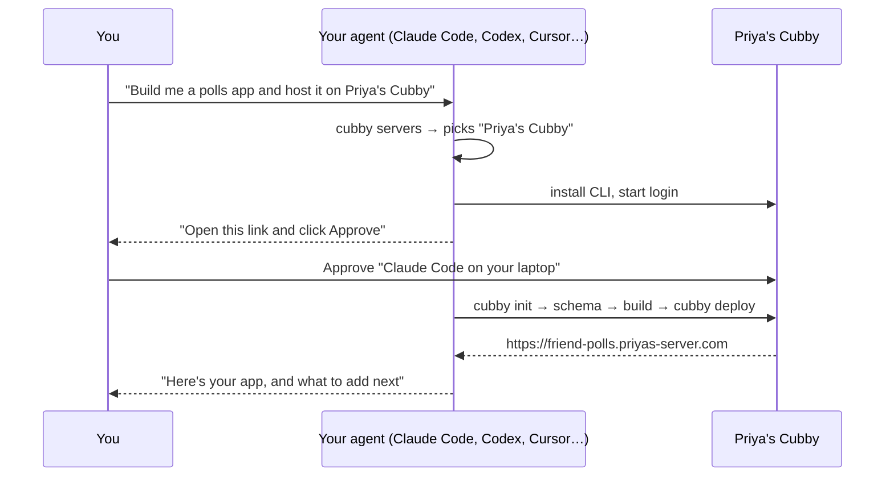
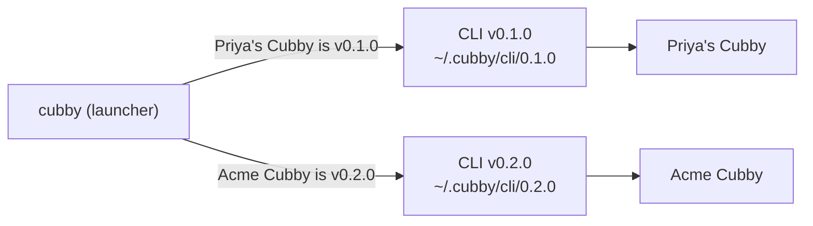
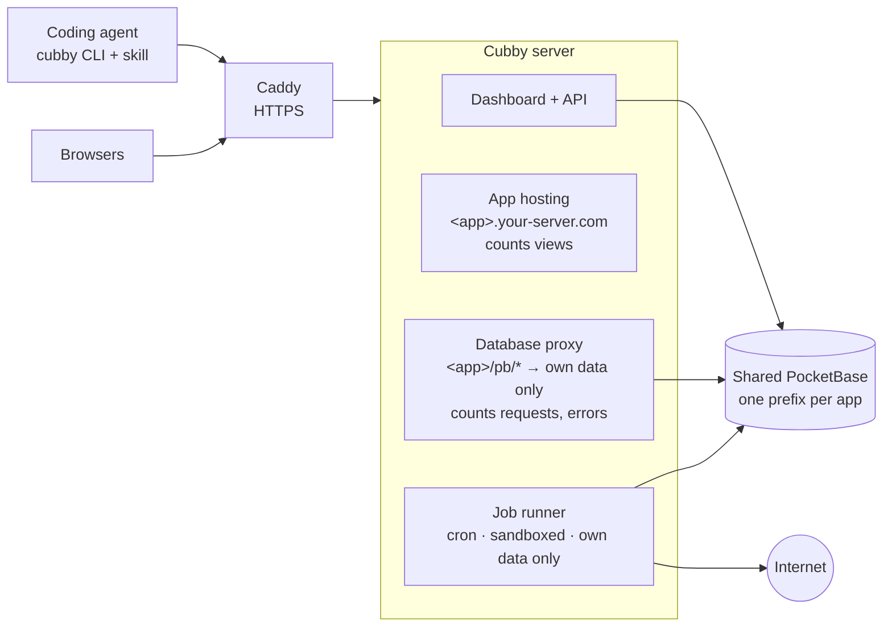

<div align="center">


# Cubby

**A home for the apps your agents build.**

Self-host one server, give it a name like **Priya's Cubby**, invite your friends or team, and let everyone's
AI coding agent build, deploy and share full-stack apps — each with a real database, logins and a live URL.

[**Documentation**](https://chaitanyadukkipaty.github.io/cubby/) ·
[Install](#install-a-server) ·
[Several servers](#belong-to-several-cubbies) ·
[How it works](#how-it-works) ·
[Contributing](CONTRIBUTING.md)

[](https://github.com/chaitanyadukkipaty/cubby/actions/workflows/ci.yml)
[](https://chaitanyadukkipaty.github.io/cubby/)


<sub>Friend Polls: built and deployed by Claude Code from one sentence, in about three minutes.</sub>

</div>

---

## What it feels like

You type one sentence to your coding agent:

> Build me an app where my friends can create polls and vote on them, and host it on Priya's Cubby.

The agent finds the server you named, sets itself up, sends you **one link to approve**, designs the data model and
its security rules, builds the UI, deploys it, and replies with the URL. Your friends see it in the server's gallery
and can use it right away.



A week later you ask for more, and it doesn't have to happen in anyone's browser:

> Close polls automatically when they expire, and email everyone a digest of new polls every Monday.

The agent stores the email service's API key as a secret, writes two **scheduled jobs** next to the app, deploys,
runs each one once to check it works, and tells you when they'll run next.

And when something changed and you're not sure who did it, ask: *"what happened to friend-polls this week?"*

```sh
cubby activity friend-polls
# 2026-10-17 09:31  friend-polls  Claude Code · laptop  Ran job "weekly-digest" now (ok)
# 2026-10-17 09:30  friend-polls  Claude Code · laptop  Deployed k3x9q2 (14 files)
# 2026-10-17 09:29  friend-polls  Claude Code · laptop  Added secret EMAIL_API_KEY
# 2026-10-16 18:02  friend-polls  dashboard             Updated "friend-polls": made it unlisted
```

And when you wonder whether anyone uses it:

> How many people used the polls app this week?

The agent runs `cubby metrics friend-polls --range 7d` and tells you the page views and unique visitors per day,
how many people are on it right now and the busiest moment of the week, which pages they open, how many accounts
signed up, and whether its database calls started failing after the last deploy. Cubby counts all of it itself as it serves the app, so there's no tracking script,
cookie banner or analytics account. The same numbers are charted on the app's page in the dashboard, with every
deploy drawn through the charts, so "did the last deploy break something?" is one glance.

## Why Cubby

Coding agents can write a whole web app from a sentence. **Hosting it is the hard part**: it needs a database,
user accounts, a URL, and a way for friends to use it. Hosted builders solve that, but your apps live on someone
else's platform and you can't bring your own agent.

|  | **Cubby** | Hosted builders | A VPS by hand |
| --- | :---: | :---: | :---: |
| You own the server and data | ✅ | — | ✅ |
| Use the agent you already like | ✅ | — | ✅ |
| Database, logins, uploads, realtime per app | ✅ | ✅ | per app, by hand |
| One-command deploys the agent runs itself | ✅ | ✅ | — |
| Friends get their own accounts and apps | ✅ | separate accounts | — |

## Features

- **Agent-native.** A skill teaches Claude Code, Codex, Cursor and OpenCode to set up, build and deploy by themselves. They log in through a browser approval, so nobody pastes passwords or tokens into a chat, and each login becomes its own named agent ("Claude Code · your-laptop") with its own key.
- **Real backend for every app.** Collections, user accounts, file uploads and live updates from a shared [PocketBase](https://pocketbase.io). Each app is walled off by collection prefix, and its security comes from database rules.
- **One-command deploys.** `cubby deploy` pushes schema changes, builds and publishes. The last 10 deploys are kept for instant rollback.
- **Scheduled jobs.** Apps can run code on a cron schedule (digests, reminders, cleanups, syncing from an API) with encrypted secrets. Each run is sandboxed and can only reach its own app's data and the public internet.
- **Know who did what.** Every change (deploys, rollbacks, schema, secrets, jobs, logins, admin actions on users, apps and backups) is logged
  for 30 days with the agent that made it, or "dashboard". `cubby activity` shows yours; admins can see everyone's.
- **Built-in metrics.** Page views, unique visitors, who's on the app right now (and the hourly peak), the top pages, API requests and errors next to each deploy, and accounts and signups per app, for up to a year, counted on the server as it serves the app: no script in the app, no cookies, and no IP addresses stored. `cubby metrics` shows them; each app's page in the dashboard charts them on one time axis with a line for every deploy; admins see every app with `--all`.
- **Clear test data, safely.** Empty or drop collections, or delete records by filter, without deleting the app, from your agent (`cubby data clear`) or the app's **Data** tab, which shows exactly what would go before it lets you delete. A snapshot is always kept for 7 days, and `cubby data restore` (or **Restore** on the tab) brings it back.
- **Safe by default.** Schema pushes never delete data. Apps can't touch each other's data or logins. Only owners can change their apps.
- **Made for groups.** Each server has its own name ("Priya's Cubby"). Invite with a signup code and browse everyone's apps on Explore. The **Admin** page has tabs, each with its own link: **Overview** (server-wide views charted over 7 days, the busiest apps, the most active agents across every user, the disk at a glance and updates), **Users**, **Apps** (with each app's older deploys), **Agents**, **Jobs**, **Settings** (name, invites, limits, how many backups to keep) and **Storage**.
- **A dashboard that follows your agents.** Home is a timeline of what your agents did, one line each, grouped by day: a deploy you don't like is one **Roll back** away, and a failed job comes with a fix-it prompt to paste into your agent. Next to it: who's on your apps right now, views over the last 7 days, your agents, and ready-made prompts for what to ask next. **Agents** lists every agent you connected, with the apps it touched; rename or revoke one there, or open it to see everything it did. Each app has its own page with tabs (Overview charts, Activity, Deploys with rollback, Jobs, Env, Data and Settings), and every tab has its own link.
- **Quick to get around.** Press ⌘K (Ctrl+K) anywhere in the dashboard to jump to a page or one of your apps, copy the setup prompt or a common command, switch theme or log out.
- **Many servers, one agent.** Belong to your friends' cubby and your team's: one skill and one CLI know them all by name, even when they run different Cubby versions.
- **Easy to run.** One install script, one Docker container, automatic HTTPS, nightly backups, and versioned releases: the Admin page tells you when one is out, and `cubby-server upgrade` installs it after a backup. Admins see where the disk goes on the Admin page's **Storage** tab (a bar of database, uploads, live and old deploys, backups, snapshots and free space; every app's size; backups to take, delete or copy the restore command for), and their agent can do the same with `cubby admin storage`, `cubby admin backups` and `cubby admin deploys`.

<table>
<tr>
<td width="50%"><p align="center"><sub>Home on Priya's Cubby: what your agents did, and what to ask next</sub></p></td>
<td width="50%"><p align="center"><sub>An app's Overview: every chart shares one time axis, with deploys drawn through</sub></p></td>
</tr>
<tr>
<td width="50%"><p align="center"><sub>Agents: rename, revoke, or connect another</sub></p></td>
<td width="50%"><p align="center"><sub>First visit: connect your agent in three steps</sub></p></td>
</tr>
<tr>
<td width="50%"><p align="center"><sub>Explore: everyone's apps</sub></p></td>
<td width="50%"><p align="center"><sub>One click to connect an agent to a named server</sub></p></td>
</tr>
<tr>
<td width="50%"><p align="center"><sub>Apps: who's on each app, 7-day views, and which agent deployed it</sub></p></td>
<td width="50%"><p align="center"><sub>Deploys: roll back to any kept deploy</sub></p></td>
</tr>
<tr>
<td width="50%"><p align="center"><sub>Admin Overview: the whole server at a glance</sub></p></td>
<td width="50%"><p align="center"><sub>Admin Storage: where the disk goes, backups and snapshots</sub></p></td>
</tr>
</table>

## Install a server

On a Linux VPS with ports 80 and 443 open (in IP mode, any free port works; see below):

```sh
curl -fsSL https://raw.githubusercontent.com/chaitanyadukkipaty/cubby/main/install.sh | sudo bash
```

It asks for a domain (optional), an admin email, a password and a name for your server (like "Priya's Cubby"),
then prints your URL and a **signup code**.
Send both to your friends.

| Mode | App URLs | HTTPS |
| --- | --- | --- |
| **Domain** (point `example.com` and `*.example.com` at the server) | `https://<app>.example.com` | Automatic |
| **No domain** | `http://<app>.203-0-113-5.sslip.io` | No, so traffic is unencrypted |

Switch later with `sudo cubby-server set-domain example.com`. See the [full install guide](https://chaitanyadukkipaty.github.io/cubby/#install).

**Port 80 already taken** (by nginx, another app…)? In IP mode the installer says what holds it and offers a free
port, e.g. 8080, so your URL becomes `http://203-0-113-5.sslip.io:8080` and apps
`http://<app>.203-0-113-5.sslip.io:8080`. Open that port in your cloud firewall. The port is kept for good, since it's
part of every URL. A domain always needs 80 and 443, because Let's Encrypt only checks those; the installer and
`set-domain` refuse, naming what holds them, until they're free.

### Choose a version, and upgrade

The installer installs the **latest release**. To pick something else, pass options after `bash -s --`:

```sh
curl -fsSL https://raw.githubusercontent.com/chaitanyadukkipaty/cubby/main/install.sh | sudo bash -s -- --version 0.1.1
curl -fsSL https://raw.githubusercontent.com/chaitanyadukkipaty/cubby/main/install.sh | sudo bash -s -- --ref my-branch
```

`--domain`, `--no-domain`, `--admin-email`, `--admin-password-file` and `--name` answer the questions up front, for an
install with no prompts. `--http-port <port>` (IP mode) and `--pb-port <port>` (PocketBase admin, loopback only,
default 8090) pick the host ports; without a terminal, a busy port stops the install with the option to pass.

When a new release is out, the Admin page says so, with the release notes. On the server:

| Command | Does |
| --- | --- |
| `sudo cubby-server upgrade` | Back up, then move to the latest release (or keep following the branch you installed) |
| `sudo cubby-server upgrade --version 0.1.1` | Move to a specific release, including rolling back |
| `sudo cubby-server upgrade --ref <branch\|tag\|commit>` | Run any ref, e.g. to try a fix before it's released |
| `sudo cubby-server version` | Show what's running, what it follows, and the latest release |

A server built from a release reports its version, like `0.1.1`. Anything else reports the commit too, like
`0.1.1-dev+b2cb75c`, so you always know exactly what code is running. Releases are cut by the maintainer and published
automatically; see [Releases](CONTRIBUTING.md#releases).

### Disk and backups

Every night Cubby backs up the database and the deployed sites, and keeps the newest 7 (a server setting). As the
admin, open **Admin → Storage** in the dashboard: a bar shows where the disk goes (database, uploads, live deploys,
old deploys kept for rollback, backups, data-clear snapshots, what isn't Cubby's, and free space), with every app's
share below. Each backup has a **Delete** (it says which files go and how much space that frees, warns when it's the
newest, and asks again for the only one) and the exact `sudo cubby-server restore <date>` command to copy;
**Back up now** takes one right away. **Settings → Backups** shows what a new retention would delete and free (or
add) before you save it, and **Apps → Deploys** lists and deletes an app's older deploys.

Your agent can do the same from your own machine, with your admin login:

```sh
cubby admin storage                    # database, uploads, current and older deploys, backups, free disk; per app
cubby admin backups                    # backups by date: database size, sites size, total
cubby admin backups create             # back up now (waits until it's done; --no-wait to return at once)
cubby admin backups delete 2026-10-01 --yes
cubby admin backups keep 3 --yes       # keep 3 nightly backups from now on; says what that deletes and frees
cubby admin deploys blog               # every deploy of an app, * marks the one it serves
cubby admin deploys blog prune --keep 2 --yes      # delete older deploys, oldest first, sparing the newest 2
cubby admin deploys blog delete <deploy-id> --yes  # delete one older deploy
```

**How many backups to keep** (1 to 90) is a server setting. `BACKUP_KEEP` in the env file only seeds it on first boot;
servers set up before the setting existed keep using `BACKUP_KEEP` (7 if unset) until you change it. The change applies
at the next nightly backup, which deletes whole pairs by date beyond the newest N. `keep` tells you first: lowering
it prints the dates that will go and the space that frees, and needs `--yes`; raising it estimates the extra disk
from your average backup.

**Older deploys** are what `cubby rollback` goes back to (each app keeps its last 10). Deleting them frees their
files and their jobs and takes them off the app's rollback list. The deploy an app is serving is never deleted:
roll back to another one first if you really want it gone.

A backup is a pair of files, `cubby-<date>.zip` (database) and `sites-<date>.tar.gz` (sites and the secrets key), and
delete always removes both. Deleting the newest backup prints a warning; deleting the only one is refused unless you
add `--leave-none`. The storage numbers are measured when you ask and reused for 5 minutes. Restoring stays on the
server, on purpose: `sudo cubby-server restore <date>`. Anyone who isn't an admin gets a clear "needs an admin
account" error.

## Connect your agent and build

1. Open the server URL and **sign up** with the signup code.
2. Copy the setup prompt from your dashboard (on Home the first time, then **Connect a new agent** on the Agents page) and paste it into your agent (Claude Code, Codex, Cursor or OpenCode),
   once per server. It has your server's name and URL filled in:
   ```text
   I'd like you to set up Cubby: Priya's Cubby at https://your-server.com, a self-hosted server where you build and host web apps for me.
   Install it as a skill if I have npm: npx skills add chaitanyadukkipaty/cubby --skill cubby -g
   If not, do this instead: curl -fsSL https://your-server.com/skill.sh | sh
   After installing, read ~/.agents/skills/cubby/SKILL.md and follow its Setup to connect to https://your-server.com (you'll send me a link to approve), review the docs at https://your-server.com/docs.md and ask me what I'd like to build.
   ```
   The agent installs the `cubby` skill (from GitHub with `npx skills add`, or from your server's `/skill.sh` without
   npm), sends you a link to approve, and adds the server to `~/.cubby/config.json`. It's a prompt rather than a
   bare `curl … | sh` so the agent knows what you're asking for: pasted on its own, agents rightly flag a pipe-to-shell
   from an unfamiliar domain as suspicious. You can also just give your agent the server's URL: fetched by anything that
   isn't a browser (curl, an agent's fetch tool), the root page answers with these setup steps as plain text.

   The approval page says which agent is asking ("Claude Code on chaitanya-mbp wants access"): the CLI tells the
   server which agent tool it runs under (Claude Code, Codex, Cursor, otherwise "Terminal"; `--client` overrides it)
   and the machine's name. Each approved login becomes its own **agent** with its own key, so your laptop's Claude
   Code and your desktop's Codex are two agents, not one shared token. `cubby agents` lists them with when each was
   last seen and marks the one asking; the dashboard's **Agents** page shows the same list with the apps each agent
   touched. The token for scripts and CI (on the Agents page) is listed as "Manual token".

   Lost a laptop, or done with an agent? Click **Revoke** next to it on the Agents page, ask any of your agents to
   revoke it, or run it yourself:

   ```sh
   cubby agents                                      # ID, name, tool, machine, created, last seen
   cubby agents rename p3n7w9s2t5u8v1y "Old laptop"
   cubby agents revoke p3n7w9s2t5u8v1y --yes         # that key stops working on its next request
   ```

   Your other agents keep working. An agent can revoke itself too, which logs it out like `cubby logout`.
   **Regenerate** on the Agents page replaces only the manual token; agents keep their own keys.
3. Ask your agent for an app in plain words, naming the server if you have more than one. That's it.
4. Your dashboard's Home then shows what your agents do, newest first. If a deploy broke something, **Roll back** on
   its line serves the one before it again; if a scheduled job failed, **Copy fix-it prompt** gives your agent the
   app, the job and how to read its log. In a terminal, `cubby activity` answers "which agent deployed this?": every change to your apps and agents from the
   last 30 days, newest first, with the agent that made it. Changes made from the dashboard (or with the manual
   token) say "dashboard". Filter with `cubby activity <app>`, `--agent <id>` (from `cubby agents --json`) or
   `--agent dashboard`, and `--limit`. Reads aren't logged, and secrets show up by name only, never their values.

<details>
<summary><b>CLI reference</b> (your agent runs these; every command takes <code>--json</code>)</summary>

| Command | What it does |
| --- | --- |
| `cubby login <server>` | Log in by approving a link in the browser (`--token` for CI). Adds the server to your list. Each approved login is a new named agent. |
| `cubby agents` | Your agents: one per approved login, with tool, machine, date and last seen; `*` marks this one |
| `cubby agents rename <id> <name>` / `cubby agents revoke <id> --yes` | Rename an agent, or revoke its key at once (revoking this agent logs it out here) |
| `cubby activity [app] [--agent <id>] [--limit n]` | What changed in the last 30 days and which agent (or the dashboard) did it; `--all` for admins |
| `cubby servers` / `cubby use <name>` | List your servers with their names and versions, set the default |
| `cubby logout [--server <name>] [--all]` | Forget one server (the current one by default) or all of them |
| `cubby init <app>` | Create an app from the template |
| `cubby deploy -m "…"` | Push schema if changed, build, publish (`--unlisted` hides it from the gallery) |
| `cubby deploys` / `cubby rollback <id>` | List deploys, restore one instantly (with the jobs it shipped) |
| `cubby jobs [run \| logs \| pause \| resume <job>]` | List scheduled jobs with their next and last run; run one now and print its log |
| `cubby env list \| set NAME=value \| unset NAME --yes` | Secrets for jobs (`--from-stdin` keeps a value out of shell history) |
| `cubby metrics [<app>] [--range 1h\|24h\|7d\|30d\|1y]` | Views, visitors, active now and peak, top paths, API requests and errors, deploys in the range, accounts and signups of one app, or a summary of all yours (last 24h by default); `--all` for admins sums every app |
| `cubby schema push \| pull \| drop` | Manage the data model (push never deletes) |
| `cubby data list [<app>]` | Collections with their record counts and uploaded file sizes |
| `cubby data clear [<app>] --collections a,b [--drop] --yes` | Empty collections (keeping fields and rules) or drop them, after a 7-day snapshot |
| `cubby data clear [<app>] --collection c --filter "…" \| --ids a,b [--dry-run] --yes` | Delete matching records only; `--dry-run` shows matches N of M, samples and cascades |
| `cubby data snapshots [<app>]` / `cubby data restore <id> [--overwrite --yes] [--dry-run]` | List snapshots of clears; restore one (additive: existing ids are skipped) |
| `cubby data clear [<app>] --wipe --yes` / `cubby data purge <id> --yes` | Drop every collection (the next deploy recreates them); delete a snapshot early. Admins clearing others' apps add `--reason` |
| `cubby projects` / `info` / `delete` | Manage apps |
| `cubby link <app> --server <name>` | Attach this folder to an app, or move it to another server |
| `cubby admin storage` | Admins: disk use by category (database, uploads, current/older deploys, backups) and per app |
| `cubby admin backups [create \| delete <date> --yes \| keep <n>]` | Admins: list backups by date, back up now, delete a backup pair (`--leave-none` for the only one), set how many nightly backups to keep |
| `cubby admin deploys <app> [prune [--keep <n>] \| delete <id>] --yes` | Admins: list an app's deploys, delete older ones oldest first or one by id (never the current one) |
| `cubby skill install \| remove \| status` | Manage the agent skill |
| `cubby version` | Show which CLI version runs for the current server, and the server's version |
| `cubby help [<command>] [--json]` | Every command and flag the targeted server supports |

`--server <name|url>` works on every command.

</details>

## Belong to several cubbies

Most people end up on more than one server: a friends' cubby and a team's, say. One skill and one CLI handle all of
them by name:

Paste each server's setup prompt into your agent once. The first server you add becomes the default for new apps;
`cubby use <name>` changes it.

```sh
cubby servers
# * Priya's Cubby   https://priyas-server.com  alex@example.com  v0.1.0
#   Acme Cubby      https://cubby.acme.dev     alex@acme.dev     v0.2.0
```

- **New apps** go to the server you name ("host it on Acme Cubby"). With one server, the agent just uses it; if it's
  unclear, it asks once.
- **Existing apps** are pinned to their server in `cubby.json`, so a redeploy can never land on the wrong one.
- **The CLI always matches the server it's talking to; in an app folder, the server in `cubby.json`.** The `cubby`
  command is a small launcher. For every command that talks to a server, logging in included, it runs a CLI of that
  server's version, downloaded once into `~/.cubby/cli/<version>/`, so an older and a newer server work side by side.
  If a server is unreachable, it falls back to the last version it saw. Servers older than Cubby 0.1.1 aren't
  supported: the CLI says so and asks you to have the admin run `sudo cubby-server upgrade`.
- **Agents ask, not guess.** The skill only names the commands every server supports. For anything else the agent
  runs `cubby help --json`, which answers for the server it's targeting (the same list is in each server's
  `/docs.md`). The installed skill only ever moves forward to newer versions.



## Clear test data

Before you share an app, you'll want the test polls gone, without deleting the app or its accounts. Ask:

> Clear out the test polls and votes in friend-polls, but keep the users.

The agent checks what's there, then empties just those collections:

```sh
cubby data list friend-polls
# friend-polls: 3 collections
#   polls  base     42 records  files 1.2 MB
#   users  auth      5 records  files 0 B
#   votes  base    310 records  files 0 B
cubby data clear friend-polls --collections polls,votes --yes
# Emptied polls (42 records), votes (310 records) in friend-polls.
# Snapshot 20261017T101500-a1b2c3 keeps them until 2026-10-24. Undo with: cubby data restore 20261017T101500-a1b2c3
```

- **Empty** (the default) deletes every record and keeps the collection, its fields and rules. **`--drop`** removes the
  collection too (like `cubby schema drop`, and the next `cubby deploy` pushes `schema.json` again). A collection
  that others point at can only be dropped together with them.
- **Nothing goes without a snapshot.** First Cubby writes everything it's about to delete to
  `DATA_DIR/snapshots/<app>/<id>/`: the collections' schema, their records (one JSON line each), records of other
  collections that point at them (deleted by cascade or unlinked, reported as such), and uploaded files if they total
  100 MB or less (above that, it warns that files can't come back). Snapshots are plain files, kept 7 days, pruned by
  the nightly maintenance, deleted with the app, and shown in `cubby admin storage`.
- **Or just some records.** `--collection polls --filter 'closed = true'` (a PocketBase filter) or `--ids a,b`
  deletes only those, and only they (and their files) go in the snapshot. `--dry-run` shows "matches N of M", five
  of the records and what would go by cascade, and deletes nothing; any clear without `--yes` shows the same
  preview. More than 10,000 matches need `--all-matching`. Filters run as the server, so they get the proxy's
  check: a filter naming another app's collection, a platform collection, or a back-relation from one is refused.
- **Accounts only when you name them.** An app's users collection is never cleared unless it's listed, and then the
  result warns that restored accounts get new passwords: PocketBase never hands out password hashes, even to the
  server.
- Only the app's owner (and admins) can clear it, `--yes` is required, and each clear is in `cubby activity`.

**In the dashboard**, the app's **Data** tab does the same. It lists the collections with their records and uploaded
files, all ticked except the app's user accounts (ticking those shows the new-passwords warning). Choose **Empty**,
**Drop**, or **Delete records of one collection** by a filter: type one, click an example, or pick a "created before"
date. Nothing can be deleted until you click **Preview**, which shows "matches N of M", up to five of the records
(tick some to delete only those), what goes by cascade, and asks for an extra tick above 10,000 records. Change the
form and the preview goes stale. Then type the app's name to unlock the button; the result names the snapshot.

<p align="center"></p>

### Undo a clear

Cleared the wrong thing? Within 7 days, ask *"bring back the polls I cleared this morning"*:

```sh
cubby data snapshots friend-polls          # id, when, what, how many records, who and why, until when
cubby data restore 20261017T101500-a1b2c3 --dry-run
cubby data restore 20261017T101500-a1b2c3
# Restored snapshot 20261017T101500-a1b2c3:
#   polls: 42 restored
#   votes: 310 restored
```

- Records come back **with their original ids**, so links between them (and from other collections) still work.
  Ids that exist again are skipped, so restoring twice is harmless. `--overwrite --yes` replaces them instead,
  after saving the versions it replaces in a new snapshot.
- A **dropped** collection is recreated from the snapshot's schema, rules included. Fields removed since are skipped;
  a field whose type changed refuses the restore until it's dropped or renamed. `--dry-run` reports all of it.
- On the **Data** tab, **Restore** on a snapshot runs the dry run first and shows what comes back, what exists
  again (skipped, or replaced with **Overwrite**) and any schema drift; a field whose type changed blocks it. Restored
  accounts' new passwords are shown once.
- What can't come back the same: PocketBase sets `created`/`updated` itself and renames uploaded files (their URLs
  change), and it never hands out password hashes, not even to the server (we checked against the bundled
  PocketBase: superusers can't read them, and writing one back just sets it as a new password). So **restored
  accounts get new random passwords**, which the restore lists for you to hand out; everything else on the account
  comes back.

### When an admin clears your data

Admins can clear data in any app (spam, a runaway job, a reset), but never silently:

- An admin clearing someone else's app must give `--reason "…"` (in the dashboard: **Admin → Apps → Clear data**,
  the same Data panel with a required reason). The owner gets it in their own `cubby activity`
  ("Admin (priya@…) emptied polls — 1,204 records · snapshot … until 2026-10-24. Reason: spam flood"), at the top of
  their Home, and as a banner on the app's page, with a link to its snapshots, until they click **Dismiss** (the app's
  `admin_clear` flag, also shown by `cubby info`).
- `cubby data clear <app> --wipe --yes` wipes the database: every collection is dropped (after one snapshot) and
  the schema hash is cleared, so the app's next `cubby deploy` pushes `schema.json` again and starts empty.
- Owners can restore any snapshot of their app, including an admin's, but can't purge an admin's
  (`cubby data purge <id> --yes` works on their own); admins can restore and purge any.

## How it works



- Every app gets its own **subdomain**, so apps can't read each other's logins in the browser.
- App `polls` owns collections named `polls__*`. The proxy only lets the app reach those, and rejects logins issued by other apps.
- Apps are static **Vite + React + Tailwind** frontends; security lives in each collection's API rules.
- **Scheduled jobs** live in the app's `cubby/jobs/`, one file per job with a cron schedule (UTC). `cubby deploy`
  bundles them with the frontend. Each run is a separate Node.js process with no access to the server's files,
  environment or local network: its database client reaches only that app's collections (as admin, past the rules),
  checked by the same code as the proxy. Runs have a time limit, a memory cap and logs (`cubby jobs logs`).
- **Metrics** are counted as the server hands out an app's pages: each HTML page load by a browser is a view
  (assets, `/pb` calls and obvious bots don't count). A visitor is a hash of the IP address and browser with a salt
  that only lives in memory and changes every day (UTC), so the same person counts once a day and can't be followed
  across days; the IP itself is never stored. Counts are kept in memory and written to the database every minute
  (views per hour; views and unique visitors per day). A crash loses at most that minute, and a restart may count
  some of that day's visitors twice. Only the app's owner (and admins) can see them.
  - **Active now** is the number of visitors who loaded a page or made a `/pb` call in the last 5 minutes, kept only
    in memory (no heartbeat, nothing added to the app); the highest it reached each hour is stored as that hour's
    **peak**. Someone reading a page for more than 5 minutes without any database call drops out, so it's a floor.
    Memory stays small: about 70 bytes per active visitor, capped at 50,000 per app (3.5 MB).
  - **API health**: every `/pb` response counts as a request per hour, and 5xx responses (from PocketBase or the
    proxy) as errors. Counting never changes what the proxy allows. A realtime connection counts when it closes.
  - **Accounts** are the records of the app's own auth collections (its `users`), counted from the database when
    you ask, with signups per day over the range. Nothing extra is stored.
  - **Top paths**: each day's row keeps its 10 most viewed paths (query strings dropped, cut at 200 characters) and
    "other" for the rest, a few hundred bytes a day. Between flushes at most 1,000 distinct paths per app are
    counted; the merge keeps the top 10 of what's stored plus what's new, so it's a close approximation, not exact.
  - **Deploys** in the range come back with the numbers, so a jump in errors lines up with the deploy behind it.
  - **Retention**: hourly rows are kept 30 days; the nightly maintenance folds older ones into their day (API counts
    added up, the peak kept) and deletes them, and deletes days older than a year. An app is at most ~720 hourly and
    365 daily rows. Ranges up to 30 days are reported by the hour, longer ones (up to `1y`) by the day.
  - **Admins** get every app summed with the 10 busiest (`cubby metrics --all`, `GET /api/admin/metrics`); visitors
    are summed across apps there, so someone using two apps counts twice. Deleting an app deletes its metrics.
- One Docker container runs Caddy, the Cubby server (Node.js) and PocketBase, with a single data volume.
- Each server serves its own CLI (`/cli.tgz`), agent docs (`/docs.md`) and skill installer (`/skill.sh`), so agents
  always follow the rules of the server they're deploying to.

Read more: [security model](https://chaitanyadukkipaty.github.io/cubby/#security) · [data and rules](https://chaitanyadukkipaty.github.io/cubby/#schema) · [running the server](https://chaitanyadukkipaty.github.io/cubby/#admin)

## Develop

```sh
git clone https://github.com/chaitanyadukkipaty/cubby && cd cubby
cp .env.example .env
npm run setup     # downloads PocketBase into ./bin, installs dependencies
npm run dev       # http://localhost:8080 · apps at http://<app>.localhost:8080
```

```
server/    control API, app hosting, database proxy, dashboard (public/: an HTML shell, a stylesheet and ES modules)
cli/       the cubby CLI, the app template (template/) and the agent skill (skill/)
docker/    container entrypoint and the cubby-server management script
docs/      this project's documentation site (GitHub Pages)
tests/     unit, integration and browser tests
```

### Tests

| Command | Runs |
| --- | --- |
| `npm run test:unit` | Fast unit tests, no network |
| `npm run test:integration` | Tests against a real server and PocketBase |
| `npm run test:e2e` | Browser tests for the dashboard and the app template (Playwright) |
| `npm run coverage` | Unit and integration tests with a coverage report in `coverage/`; fails below the thresholds in `.c8rc.json` |
| `npm run coverage:unit` | Unit tests alone against their own thresholds (`.c8rc.unit.json`) |
| `npm run coverage:ratchet` | Raise both thresholds to the latest measured coverage (never lowers them) |
| `npm test` | All of the above, in pyramid order |

## Contributing

Contributions are welcome, from people and their agents. Read **[CONTRIBUTING.md](CONTRIBUTING.md)** first. In short:

1. Open an issue for anything bigger than a small fix, and agree on the approach.
2. Branch from `main` (`feat/…`, `fix/…`, `docs/…`) and use [Conventional Commits](https://www.conventionalcommits.org/).
3. Add tests at the right level of the pyramid, update the docs, and run `npm test`.
4. Open a pull request using the template. `main` is protected: changes land only through pull requests with passing CI,
   squash-merged.

Please follow our [Code of Conduct](CODE_OF_CONDUCT.md), and report security problems privately as described in [SECURITY.md](SECURITY.md).
Notable changes are listed in the [changelog](CHANGELOG.md).

## Status and limits

Cubby is early (v0.1.0, with server names and multi-server support in the [next release](CHANGELOG.md)). It's built
for groups who trust each other, not as a hostile multi-tenant cloud.

- All apps share one SQLite database, which suits a group of friends or a small team.
- Jobs are for groups who trust each other too: the sandbox stops accidents and snooping between apps, not a
  determined attacker with an account. At most two run at once per server.
- "Last seen" for an agent is updated at most once a minute. Home's timeline shows your latest 60 changes; older
  ones are on each agent's page and in `cubby activity`.
- The activity log keeps 30 days (pruned nightly) and shows your own actions. An admin's actions on your app (like
  deleting it) are in the admin's log, not yours, except data clears, which are in both. An app's history stays after the app is deleted, until it ages
  out; deleting a user deletes their history.
- Not yet supported: server code that runs per request (API endpoints, hooks), custom domains per app, single sign-on
  across apps, app emails.
